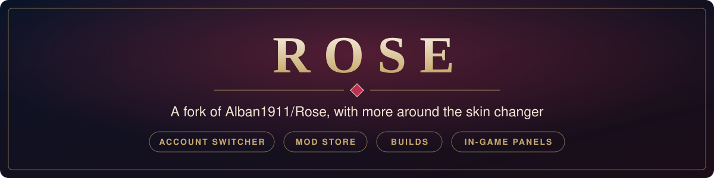
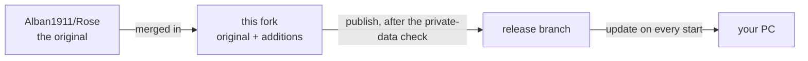

<!-- This fork's front page. GitHub shows a README in .github before the one in the root, so the original
     project's README.md stays as it is and merging the original's updates never conflicts here. -->

> [!NOTE]
> **This is a fork.** Rose, the skin changer, is the work of Alban and Florent at
> [Alban1911/Rose](https://github.com/Alban1911/Rose). This fork keeps all of it and adds the features on this
> page. The original's own README is kept unchanged: [read it here](../README.md).

> [!WARNING]
> **Nov 25, 2026: skins and mods may not work.** On the developer's PC, Riot Vanguard now names LTK Manager's
> patcher and every game with mods in it closes a few seconds after it starts. Nothing here hides anything from
> Vanguard. To keep playing with Rose's other features, right-click Rose's tray icon and untick **Mods in game**
> ([what that does](../docs/mods-switch.md)). After two games in a row that close this way, Rose unticks it by
> itself.

## What is whose

<table>
<tr>
<th width="50%">🌹 The original: <a href="https://github.com/Alban1911/Rose">Alban1911/Rose</a></th>
<th width="50%">🐨 Added in this fork</th>
</tr>
<tr>
<td valign="top">

- **The skin changer**: every skin, chroma and form, picked in champ select and applied when the game starts
- Custom skins, maps, fonts and announcers
- The 12 client plugins it ships: skin wheels, settings, random skin, last used skin, translations
- Party mode: friends see each other's skins
- The work with LTK Manager and Pengu Loader that makes all of it possible
- The installer, the updater and the startup diagnostics
- Rose's name, icon and look

</td>
<td valign="top">

- An **account switcher**
- A **mod store**
- **Builds** in champ select
- Three **in-game panels**: build strip (with your CS a minute), gold board, player stats
- A skin of your choice on **other players' champions**
- Party mode that **sends the skin files** to your friends
- A choice of **which mods to turn off** when you reconnect
- **Auto accept** for the match found window
- A **mod check** inside Rose
- **Install and update** straight from this repository

</td>
</tr>
</table>

As of November 2026 the fork is 5 new client plugins and about 21,000 added lines on top of the original. The
original's updates are merged in as they come, and nothing of the original is removed.

## What the fork adds

Several of these are days old. Each one's design note ends with what was checked and what was not.

### In the League client

| | Feature | What it does | More |
|:-:|---|---|---|
| 👤 | **Account switcher** | Saves your League accounts and signs the Riot Client in to the one you pick, from its own window or from the client. Shows each account's rank, and imports and exports lists. Passwords are kept in Windows Credential Manager, never in a file. Two-factor prompts stay yours to answer. | |
| 🛒 | **Mod store** | RuneForge's site in a Rose window. Press Install on a mod and it goes straight into Rose, checked and repaired first. | |
| 📋 | **Builds** | In champ select, the builds of the champion's three best one-trick players on onetricks.gg: runes, summoner spells and items, imported in one press. Once the enemy locks in, a build against your likely lane opponent. | [design](../docs/champ-select-builds.md) |
| 🎭 | **Other players' skins** | Pick the skin each other player's champion shows on your screen: a Riot skin, one of your custom skins, or none. *New: not yet proven in a real game.* | [design](../docs/other-players-skins.md) |
| 🤝 | **Party skin sharing** | In the original, a friend's custom skin shows only if you have the same file. Here the file is sent, so it appears by itself. | [design](../docs/party-mod-sharing.md) |
| 🔌 | **Reconnect choice** | After a crash, choose which mods to turn off before you reconnect, in place of all of them. | [design](../docs/reconnect-mod-choice.md) |
| ✅ | **Auto accept** | Accepts the match found window for you. A check mark in the top bar turns it on and off: grey is off, gold is on, and it is off until you press it. *New: not yet seen in the client.* | [design](../docs/auto-accept.md) |

### In the game

Small windows over a borderless or windowed game. They read what Riot's own local game API and the League
client offer. Nothing reads or writes the game's memory.

| | Panel | What it shows | More |
|:-:|---|---|---|
| 🧱 | **Build strip** | Between the minimap and the abilities: the next items of your build and their parts, lit when you have the gold. | [design](../docs/in-game-build-guide.md) |
| 🌾 | **CS a minute** | A row of text above the build strip: your creep score per minute of game time. Ctrl+Shift+C turns it off and on. *New: not yet seen in a real game.* | [design](../docs/cs-per-minute.md) |
| 💰 | **Gold board** | Hold Tab: for each lane, the difference in item gold between you and your lane opponent. | [design](../docs/in-game-gold-board.md) |
| 📊 | **Player stats** | Ctrl+X: every player's rank, win rate and season peak, in lane order. Ranks come from the client, the rest from deeplol. Your own account is never sent there. | [design](../docs/player-stats-panel.md) |

### Under the hood

- **Mod check.** `rose-mod-check` is a small separate program built on LTK Manager's own rules. It checks and
  repairs a mod without LTK Manager opening. It is GPL like LTK Manager, which is why it stays a program of its
  own ([its license](../native/rose-mod-check/LICENSE)).
- **Install and update from GitHub.** One file to run, then Rose updates itself each time it starts. While it runs it downloads new versions too, and asks to restart when you are not in a game, a queue or champion select
  ([how](../docs/install-from-github.md)).
- **A switch for mods.** Tray icon, **Mods in game**: off, Rose loads nothing into the game and the account
  switcher, builds, panels and auto accept keep working. Rose turns it off by itself after two games in a row
  that close within seconds of starting with mods in them ([why and how](../docs/mods-switch.md)).
- **A check before every publish.** Everything sent to this repository is first searched for the developer's
  private values: names, accounts, keys. One hit and nothing is published.

## Install

1. Download **[Install-Rose.bat](https://github.com/iimKoala/Rose/releases/download/tools/Install-Rose.bat)** and
   run it. It needs Python 3.11 or newer and installs Python 3.13 when you have none. Rose goes into
   `%LOCALAPPDATA%\Programs\Rose`, with a **Rose** shortcut on your Desktop.
2. Install LTK Manager once: Rose applies skins through it. See
   [LTK Manager Requirement](../README.md#ltk-manager-requirement) in the original's README.
3. Start Rose from the shortcut. It asks for administrator rights, looks for an update, then starts.

Every step in detail, what each window means, how to check that it works, and what to do when something goes
wrong: the **[install guide](../docs/install-guide.md)**.

> [!IMPORTANT]
> This fork runs from its source, not as `Rose.exe`: its account window, mod store and in-game panels are
> separate Python programs. The original's installer gives you the original, without them.

## How the fork follows the original

The `main` branch here is a copy of the original. The `release` branch is what you install.

## Privacy

- **Your accounts stay on your PC.** The list is in `%LOCALAPPDATA%\Rose`, the passwords in Windows Credential
  Manager. Nothing of them is in this repository, and a new install starts with an empty list.
- **What the fork's features ask the internet:** onetricks.gg for builds, deeplol for the other players' stats,
  RuneForge when you open the mod store, and a relay that passes skin picks and shared skin files between the
  members of your party.
- **From the original:** Rose sends a random install ID and its version to the original project's usage
  counter. `ANALYTICS_ENABLED = False` in `config.py` turns it off.

## Credits and license

- **Rose** by Alban and Florent: [Alban1911/Rose](https://github.com/Alban1911/Rose), MIT ([LICENSE](../LICENSE)).
  The fork's additions are MIT too.
- **[Pengu Loader](https://github.com/PenguLoader/PenguLoader)**, which puts the plugins in the League client.
- **LTK Manager**, which applies the skins, and whose rules `rose-mod-check` runs.
- **onetricks.gg**, **deeplol** and **RuneForge** for what the builds, the stats and the store show. This fork
  is not affiliated with any of them.
- **GSAP** for the account window's animations.

## Disclaimer

This project is not endorsed by or affiliated with Riot Games. Riot Games does not allow custom skins that
reproduce its real skins, which is what Rose does. Use it at your own risk: an account suspension or ban is
possible, and nobody here or at the original is responsible for it.

This fork is not the original and its authors do not support it. A problem with something from the right-hand
column above is not theirs to fix, so please do not report it to them.
